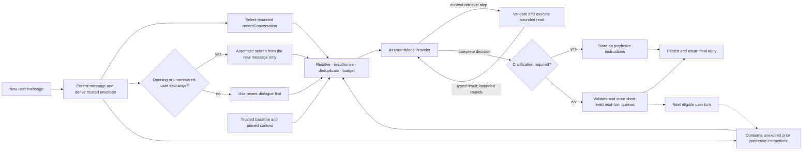

# Experimental assistant context memory and retrieval

> **Status: optional and experimental.** This is an intentionally innovative design candidate for
> application-owned AI-chat context memory and retrieval, not a mandatory stack rule. A project may
> adopt it, adapt it after recording the differences, or instead use a ready-made agent/context
> solution that owns context handling behind the project's application boundary.

This guide applies only when a project explicitly chooses this design. The general
[AI subsystem rules](AI_SUBSYSTEM.md)—the model is untrusted, application data remains
application-owned, provider state is not durable product memory, and every operation is authorized
by the application—still apply under either choice.

## Separate the three axes

Do not encode origin, retrieval method, and data source in one growing union. They answer independent
questions:

| Axis       | Question                                 | Choices in this design                                                                                             |
| ---------- | ---------------------------------------- | ------------------------------------------------------------------------------------------------------------------ |
| **Origin** | Why and when did retrieval start?        | automatic predictive, model-directed predictive, model-directed in-call                                            |
| **Method** | How is data selected?                    | relevance search or application-specific explicit retrieval                                                        |
| **Source** | Where does authoritative data come from? | raw messages, assistant memory, other processed conversational data, or application-specific authoritative sources |

An origin carries audit and policy metadata. A query describes what to retrieve. A source owns the
current records. Keeping them separate prevents query fields from being duplicated inside trigger
types. Model-directed origins may use either retrieval method; automatic predictive retrieval uses
relevance search.

Baseline context injection is not a fourth retrieval origin. A small bounded set of runtime values
and pinned records—such as the current instant, time zone, locale, or explicitly pinned identity
data—may be included on every turn without a relevance query. Generate runtime values from their
authoritative providers instead of storing them as memories.

## Context sources and authority

The source catalog is product-defined and extensible. It normally begins with:

- **Raw conversation messages.** These preserve what was said and provide evidence and conversational
  recall. A user message is evidence of the user's statement; an assistant message is not evidence
  that its content is true.
- **Assistant memory records.** These hold the current application interpretation of durable
  user-specific knowledge that is not authoritative state of another application domain. They retain
  evidence references, revision, expiry when applicable, and an explicit delivery policy.
- **Other processed conversational sources.** Conversation summaries or another measured projection
  may be separate sources when their meaning and lifecycle differ from assistant memory.
- **Application-specific authoritative sources.** These retain ownership of their domain data and
  expose typed, explicit retrieval operations such as lookup by identifier or bounded range. The
  context subsystem never replaces them with assistant-memory copies merely to make them searchable.

For immutable sourced propositions and edit-dependency tracking, use the optional
[FactDB contract](FACT_DB.md); its current delivery view can participate as a processed source without
duplicating canonical memory. The current-state MemoryRecord pattern below remains available for
products that do not need that provenance lifecycle.

For the current-state MemoryRecord pattern, do not add subject/predicate/object fields merely
in anticipation of a future query mechanism. Store a standalone canonical statement containing the
smallest coherent information that can be corrected, expired, or deleted independently. Closely
coupled details with the same evidence and lifecycle may share one record; information that can
change independently does not. Adopt a structured contract only for a demonstrated extraction or
query requirement; sourced atomic extraction follows the separate [FactDB contract](FACT_DB.md).

Raw messages, assistant memory, and application state are not competing copies of one truth: they
have different meanings. Raw messages are evidence, memory records are the application's current
interpretation of durable conversational knowledge, and application services own authoritative
domain state. Search indexes, embeddings, selection hints, and predictive caches are derived
projections rather than new sources of truth.

For networked browser/WebView products, the server owns canonical sources, durable derived
projections, context assembly, retrieval execution, and model interaction. The client sends the new
message through a bounded authenticated conversation use case; it cannot supply the trusted access
scope, source allowlist, server time, retrieval results/instructions, or mutation authority. A
local-authoritative product is outside this server-oriented blueprint and needs a separate
architecture specification; the label cannot bypass server authentication or tenant isolation in a
networked composition.

### Route information to its authoritative owner

Do not store the same proposition in assistant memory and an application-specific source.

- A user request that is sufficiently exact and authorized to create or modify domain state belongs
  only to the application service that owns that state. Preserve useful explanatory text in that
  domain record when its contract provides notes or description fields.
- An uncertain intent that cannot yet satisfy the domain command contract may remain a current
  assistant-memory record when it is durable enough to remember. Clarification can later promote it
  to authoritative domain state; successful promotion deletes the redundant memory record.
- Other durable user knowledge belongs in assistant memory unless another application domain already
  owns it.
- Casual conversation remains in raw conversation history only.

A host may expose a [rolling summary](ROLLING_SUMMARIES.md) as a revision-bound processed source,
retaining its original-source ownership and completeness policy rather than copying its contents
into a second canonical memory collection.

The exact boundary is product-defined. The invariant is universal: a convenient retrieval copy does
not become a second authoritative record.

### Define current-truth precedence over raw evidence

Raw messages are evidence of what was said, not perpetual competing truth. A current memory record
or application-authoritative record must override conflicting older raw wording and assistant reply
history. Assistant-history is useful for conversational continuity; it cannot prove that a user fact
or application state is true.

A product may mark a raw message as represented by current authoritative state and exclude it from
automatic semantic search while retaining it for chronological conversation or explicit provenance.
That marker is current retrieval metadata, not memory-version history. Message-level suppression is
simple but can hide an unextracted proposition from a multi-fact message; products requiring stronger
recall or deletion semantics should use proposition/span-level provenance. Deleting assistant memory
does not automatically mean transcript or audit erasure—retention and permanent-forget behavior must
be specified separately and described honestly.

### Current-state assistant memory

Assistant memory is normally a current-state collection, not an append-only chain. A correction
replaces the canonical meaning under the same stable identifier and increments its revision. A user
request to forget a memory deletes it. A separate audit log may be justified by compliance or sync,
but it is not the canonical memory model and must not be required merely to imitate a ledger.

```ts
interface MemoryRecord {
  readonly memoryRecordId: string;
  readonly revision: number;
  /** Complete current meaning; not a duplicate of the source message text. */
  readonly content: string;
  readonly evidenceMessageIds: readonly string[];
  readonly deliveryMode: "retrieval" | "always-proactive";
  readonly createdAt: string;
  readonly updatedAt: string;
  readonly expiresAt?: string;
}

interface MemoryMutationEvidence {
  readonly evidenceMessageIds: readonly string[];
}

type MemoryMutationCandidate = MemoryMutationEvidence &
  (
    | {
        readonly operation: "create";
        readonly content: string;
        readonly deliveryMode: MemoryRecord["deliveryMode"];
        readonly expiresAt?: string;
      }
    | {
        readonly operation: "update";
        readonly target: {
          readonly memoryRecordId: string;
          readonly expectedRevision: number;
        };
        readonly content: string;
        readonly deliveryMode: MemoryRecord["deliveryMode"];
        readonly expiresAt?: string;
      }
    | {
        readonly operation: "delete";
        readonly target: {
          readonly memoryRecordId: string;
          readonly expectedRevision: number;
        };
      }
  );
```

The raw message already preserves exact wording. `evidenceMessageIds` is a bounded set supporting
the **current meaning** without a second `sourceText` field. Application code, not the model, owns
identifiers, revisions, timestamps, optimistic-concurrency checks, physical deletion, and whether a
correction replaces or merges current supporting evidence. Evidence must never grow into an
unbounded correction history; a latest-only reference is often the clearest current-state policy.
Lifecycle expiry and subject-matter time scope are separate. A current temporary constraint or
one-off future intention should normally expire at its applicability boundary, while a durable
historical fact may retain a finite past scope without being expired from memory.

### Evidence eligibility and memory decisions

Every memory mutation cites a nonempty bounded set of supporting user-message IDs. Trusted
application code derives and supplies the eligible set from the current message plus unanswered
user messages after the latest assistant reply. Reject a citation outside that set even when the
older message was retrieved or remains in recent conversation. Historical recall and assistant
prose provide context, not fresh mutation authority. Exact retry of an already accepted trusted
turn retains its original evidence identity and must converge.

The cited text must directly support the complete proposition or clearly adopt the requested
outcome. A question about a topic, an exploratory possibility, or an unaccepted assistant suggestion
does not establish preference, motive, ownership, habit, identity, or intention. Define a deliberate
memory decision for each directly asserted proposition: new durable knowledge, an equivalent no-op,
a correction to the same factual question, or conversation only. One-off status, mood, progress, or
accomplishment normally remains in history unless the user requests later recall or states a lasting
change or recurring pattern. Product-specific retention policy decides future usefulness; no
universal memory taxonomy is implied.

The decoder can prove citation membership, target revisions, and structural invariants; it cannot
prove arbitrary natural-language entailment or atomicity. Do not present lexical overlap as semantic
proof. Evaluate interpretation with [representative conversations](../practices/AI_EVALUATION.md),
including paraphrases, questions, unrelated facts sharing vocabulary, and read-only follow-ups.

### Derived memory-selection indexes

A general natural-language memory record plus application-specific derived indexes can support a
large share of an assistant's data-selection needs. Those indexes are often where assistants for
different application domains meaningfully differ: each product derives the selectors that make its
own memories cheap and reliable to find.

```ts
interface MemoryIndexProjection<TIndexEntry> {
  readonly memoryRecordId: string;
  /** The projection is usable only for this exact canonical revision. */
  readonly memoryRevision: number;
  readonly entries: readonly TIndexEntry[];
}

interface MemoryIndexProvider<TIndexEntry, TQuery> {
  replaceProjection(
    projection: MemoryIndexProjection<TIndexEntry>,
  ): Promise<void>;

  removeProjection(memoryRecordId: string): Promise<void>;

  findReferences(
    accessScope: ContextAccessScope,
    query: TQuery,
    limits: ContextRetrievalLimits,
  ): Promise<ContextRetrievalResult<ContextRecordReference<"memory-record">>>;
}
```

Common projections include:

- **Time-scope entries:** zero, one, or several exact/open intervals or recurring local windows for
  bounded range lookup. Date precision and clock-time precision remain independent.
- **Semantic cues:** words or phrases related to a memory but absent from its canonical text, used to
  improve lexical, semantic, or hybrid recall without bloating prompt content.
- **Application-domain indexes:** identifiers, scopes, or selectors chosen by the product because
  they support measured retrieval needs.

For local-time scopes, document the domain's handling of nonexistent or repeated wall times at
daylight-saving transitions. The model cannot resolve ambiguity by inventing a UTC offset or
increasing the user's stated time precision.

Projection entries may be derived deterministically, requested from a model as separately validated
index candidates, or produced by another adapter. In every case, trusted application code assigns
the record reference and revision and validates the closed product-specific index schema; the model
does not choose authority, access scope, ownership, or physical index fields.

Validate the canonical mutation and its disposable projection independently. Normalized duplicate
semantic cues converge to one entry; a cue that repeats canonical text may be retained or omitted by
projection policy, but it never invalidates an otherwise valid memory mutation. If optional
projection input cannot be used or projection persistence fails, commit valid canonical memory and
report or queue deferred index repair. Never silently drop the canonical mutation, report it failed
after it committed, or claim it succeeded when the canonical write did not commit.

Index entries deliberately duplicate selection information. They are disposable and are never sent
to the model as authoritative canonical claims. A hit returns a record reference; prompt assembly
reloads the current memory, verifies that the projection revision still matches, and rechecks access
and expiry. Lookup-only aliases/cues stay out of prompt context. A product may additionally deliver
revision-matched temporal scope/precision as explicitly derived metadata when reasoning must preserve
known ambiguity; it must not silently promote that projection into canonical truth. An index may be
rebuilt from current records or stored separately for speed. A search library's private physical
schema stays behind its adapter.
Canonical memory is the commit point. If a disposable projection write fails after that commit, the
mutation result reports index maintenance as deferred and preserves enough trusted repair input for
an exact retry or rebuild; it does not report the accepted canonical write as failed and invite a
duplicate memory.

This pattern is powerful, but not restrictive. An application may—and often should—keep other
authoritative sources when their data has stronger invariants, transactional behavior, or definitive
typed retrieval. Those sources may publish disposable search projections while retaining explicit
retrieval through their owning services. Choosing assistant memory, another authoritative source, or
both for distinct responsibilities is an application-design decision.

### Durable derived-index lifecycle

Persist enough server-owned projection input to rebuild a private search engine without depending on
transient client storage or regenerating unchanged embeddings. Cache document embeddings by a
deterministic identity containing at least normalized source text (or its cryptographic digest),
embedding provider/model, dimensions, and any task/config that changes vector meaning. A generation
timestamp such as `embeddedAt` supports diagnostics, retention, and rebuild policy; it does not by
itself decide cache correctness.

Do not synchronously regenerate an entire corpus in a user turn. Commit canonical data first, make a
lexical or otherwise deterministic projection available promptly, and queue missing/stale document
embeddings in a bounded server worker. Read atomically committed semantic snapshots while document
work runs. Completeness is query-specific: an excluded or inaccessible pending document cannot make
an otherwise covered query unavailable. Revision/generation checks prevent a late older batch from
overwriting a newer projection; successful independent batches survive a peer's failure. Bound
background concurrency and retry/backoff, and retain missing-vector state for repair after transient
exhaustion or restart.

Declare whether semantic coverage is optional or required for each retrieval policy. Optional
coverage may return lexical results with explicit incompleteness. Required coverage must return an
unavailable result when it cannot be supplied; lexical success cannot silently stand in for semantic
success. Query embeddings are normally request-specific; cache them only with a measured reuse and
privacy policy.

When measured outages or tail latency justify independent embedding fallback, keep each vector space
warm in its own index/cache identity, with its own dimensions, task configuration, and calibrated
thresholds. Never compare or combine raw similarity scores across incompatible spaces. A bounded
delayed hedge may take the first result satisfying the declared coverage policy; a fast failed or
incomplete attempt does not win. Account for every attempt, including a losing request that still
incurs usage. This is an optional availability mechanism, not a requirement to run two providers.

Document update/deletion must invalidate or replace its revisioned projection. Cached vectors may be
content-addressed and shared across equal permitted text, but need retention, model-version cleanup,
and deletion policy. Neither a persisted search document nor a cached vector becomes canonical truth.

### Embedding adapter contract

Keep query and document embedding operations distinct, mapping each to the model's required task
mode or prefix. They must use a compatible model/configuration within one vector space. Bound text
length, item count, and aggregate batch size before provider work. Validate exactly one result per
input, reconstruct input order from checked unique indexes when returned out of order, and reject
missing/duplicate items, wrong dimensions, non-finite components, or zero-magnitude vectors. Apply
the declared normalization before cosine scoring; malformed vectors cannot enter persisted caches
or search snapshots. Library/SDK types do not replace these runtime checks.

Calibrate each model/configuration's acceptance threshold against
[retrieval evaluation](../practices/AI_EVALUATION.md#retrieval-and-speech-qualification). A numerically
high similarity is not evidence that the user's question has a stored answer. Keep an explicit
no-relevant-context outcome; do not force the nearest record into every prompt. Changes to
dimensions, task mode, normalization, or thresholds require the corresponding reindex/requalification
decision, rather than reuse of previously calibrated scores by model name alone.

### Searchable application data

An application source may publish selected free-text fields into the relevance index while retaining
definitive retrieval through its typed repository methods. The source defines its smallest useful
retrieval unit: a record, an aggregate, or another bounded domain block. A search hit points to that
unit, and the subsystem reloads the complete current unit from its authoritative source before prompt
assembly.

Use **explicit** to name the retrieval method; the hydrated result is **definitive** only because it
comes from the source that owns that application data.

## The three retrieval origins

### 1. Automatic predictive context retrieval

On an opening turn, or when the bounded conversation ends with an unanswered user message, relevance
search runs after the server receives the new message but before the model sees it. It uses **only
that new message** as the source of `queryText`; it does not silently expand the query with earlier
turns. After a completed assistant exchange, exact recent conversation carries dialogue continuity
first and the model may request a focused in-call read only when durable context is genuinely needed.
Provider-independent normalization and the declared query-length limit may still apply. Context that
the previous model turn predicted is supplied through the next origin.

This origin is automatic because application code starts it and predictive because lexical,
semantic/vector, or hybrid search estimates which stored records will help. It is not a model tool
call. The new raw message is excluded from its own search results; save it before orchestration when
required, but index it only after this search or pass its reference as an explicit exclusion.
Exclude messages already supplied in bounded recent conversation from every relevance query as
well; their exact text is present and duplicate historical hits add no evidence. These exclusions
also apply when assessing whether missing document vectors affect the current query.

### 2. Model-directed predictive context retrieval

A completed model turn may return hidden, typed retrieval instructions for a future turn alongside
its visible answer. The application validates and stores accepted instructions with a short
application-assigned turn expiry. On the next eligible turn it executes each instruction and supplies
the permitted results to the model.

A response that asks a necessary clarification returns no predictive instructions. The bounded
recent-conversation window carries the unresolved exchange into the user's answer; if that clarified
turn needs durable or domain context, the model requests a focused in-call read after interpreting
the answer. This prevents an unaccepted assistant suggestion from becoming a retrieval anchor.

The application does not rerank or discard those results against the next user message: deciding
their anticipated relevance was the model's job. It still enforces ownership, authorization,
lifecycle, source allowlists, query schemas, and hard result/token limits. Identity deduplication
against other retrieval results is not a relevance decision. If a hard limit truncates a result, the
model receives an explicit incomplete-result marker.

Store the accepted query and, when safe, cached source references—not copied canonical content.
Resolve current records and recheck access on the consuming turn. Volatile application-specific
queries execute against their authoritative source on that turn so prediction cannot freeze stale
domain state.

### 3. Model-directed in-call context retrieval

After seeing the current prompt, the model may discover that context is still missing and issue a
typed tool call. The application validates and executes the query, returns bounded results to the
same model interaction, and lets the model continue. The user need not receive an intermediate
"cannot answer" message.

Limit retrieval rounds and repeated equivalent queries. A prompt can suggest a tool call, but cannot
authorize a source, enlarge a budget, or create a new explicit operation.

An intermediate retrieval step contains only read queries, with no visible reply or proposed
mutation. At the round limit, supply one explicit terminal continuation that disallows further
reads; the model must answer from available evidence and state material uncertainty. Only a
validated final decision becomes a visible/persisted assistant reply or reaches mutation policy.

Treat an in-call read requested to complete the decision as a prerequisite: a failed, rejected, or
incomplete required read makes that decision ineligible for memory or domain writes. Enforce this in
application validation, not only the prompt. Incomplete automatic/predictive background retrieval
does not alone block a write supported directly by eligible current user evidence and all required
domain revisions. Neither an empty partial result nor exhausted reads prove that a record does not
exist.

## Provider-neutral contracts

The names below define roles, not one storage engine or model SDK. An implementing project narrows
`TSourceId` to its closed source-ID union and `TExplicitQuery` to a schema-validated closed union of
its own typed retrieval operations.

```ts
interface ContextRecordReference<TSourceId extends string> {
  readonly sourceId: TSourceId;
  readonly recordId: string;
  readonly revision?: string;
}

interface ContextAccessScope {
  readonly principalId: string;
  readonly ownerId: string;
  readonly tenantId?: string;
}

type ContextRetrievalOrigin =
  | {
      readonly type: "automatic-predictive";
      readonly userMessageId: string;
    }
  | {
      readonly type: "model-directed-predictive";
      readonly assistantResponseId: string;
      readonly instructionId: string;
    }
  | {
      readonly type: "model-directed-in-call";
      readonly turnId: string;
      readonly toolCallId: string;
    };

interface RelevanceContextRetrievalQuery<TSourceId extends string> {
  readonly method: "relevance-search";
  readonly queryText: string;
  readonly sourceIds: readonly TSourceId[];
  readonly excludedSourceReferences: readonly ContextRecordReference<TSourceId>[];
}

type ContextRetrievalQuery<
  TSourceId extends string,
  TExplicitQuery extends { readonly method: "explicit" },
> = RelevanceContextRetrievalQuery<TSourceId> | TExplicitQuery;

interface ContextRetrievalLimits {
  readonly maximumResults: number;
  readonly maximumQueryCharacters: number;
}

interface ContextPromptBudget {
  readonly maximumPromptTokens: number;
}

interface ContextRetrievalRequest<
  TSourceId extends string,
  TExplicitQuery extends { readonly method: "explicit" },
> {
  readonly requestId: string;
  readonly origin: ContextRetrievalOrigin;
  readonly query: ContextRetrievalQuery<TSourceId, TExplicitQuery>;
  /** Created by trusted application code; never accepted from model output. */
  readonly accessScope: ContextAccessScope;
  /** Assigned by application policy; never accepted from model output. */
  readonly limits: ContextRetrievalLimits;
  /** Applied after authoritative records are resolved and rendered. */
  readonly promptBudget: ContextPromptBudget;
}

interface ModelPredictiveContextRetrievalInstruction<
  TSourceId extends string,
  TExplicitQuery extends { readonly method: "explicit" },
> {
  readonly instructionId: string;
  readonly query: ContextRetrievalQuery<TSourceId, TExplicitQuery>;
}

interface PendingModelPredictiveContextRetrievalInstruction<
  TSourceId extends string,
  TExplicitQuery extends { readonly method: "explicit" },
> {
  readonly instruction: ModelPredictiveContextRetrievalInstruction<
    TSourceId,
    TExplicitQuery
  >;
  /** Assigned by application policy; the model cannot extend its own instruction lifetime. */
  readonly expiresAtTurnSequenceExclusive: number;
}
```

The model supplies only the proposed predictive instruction. Trusted application code adds its
request identifier, origin, access scope, retrieval limits, prompt budget, and expiry after
validation. An automatic request always uses `RelevanceContextRetrievalQuery` with the newly received
message as the only source of `queryText` and excludes that message's own source reference.

An explicit query is not a string operation name plus arbitrary parameters. The product defines a
closed discriminated union whose variants carry their fully typed values. Its provider delegates
each variant to the existing application service or repository; it never accepts SQL, storage keys,
or an unrestricted endpoint name from the model.

### Disposable search projection

```ts
interface ContextSearchDocument<TSourceId extends string> {
  readonly documentId: string;
  readonly sourceReference: ContextRecordReference<TSourceId>;
  readonly searchableText: string;
  readonly accessPartition: {
    readonly ownerId: string;
    readonly tenantId?: string;
  };
}

interface ContextRetrievalHit<TSourceId extends string> {
  readonly sourceReference: ContextRecordReference<TSourceId>;
  readonly score: number;
  readonly matchedBy: "lexical" | "vector" | "hybrid";
}

type ContextRetrievalOmissionReason =
  | "result-limit"
  | "prompt-token-limit"
  | "source-unavailable"
  | "record-unavailable";

interface ContextRetrievalResult<TItem> {
  readonly items: readonly TItem[];
  readonly isComplete: boolean;
  readonly omissionReasons: readonly ContextRetrievalOmissionReason[];
}

interface ContextSearchIndexProvider<TSourceId extends string> {
  upsert(documents: readonly ContextSearchDocument<TSourceId>[]): Promise<void>;

  remove(documentIds: readonly string[]): Promise<void>;
}

interface ContextRetrievalProvider<TSourceId extends string> {
  retrieve(
    accessScope: ContextAccessScope,
    query: RelevanceContextRetrievalQuery<TSourceId>,
    limits: ContextRetrievalLimits,
  ): Promise<ContextRetrievalResult<ContextRetrievalHit<TSourceId>>>;
}

interface RetrievedContextItem<
  TSourceId extends string,
  TAuthority extends string,
> {
  readonly sourceReference: ContextRecordReference<TSourceId>;
  readonly promptText: string;
  readonly authority: TAuthority;
}

interface ContextSourceProvider<
  TSourceId extends string,
  TAuthority extends string,
> {
  readonly sourceId: TSourceId;

  resolve(
    accessScope: ContextAccessScope,
    references: readonly ContextRecordReference<TSourceId>[],
  ): Promise<
    ContextRetrievalResult<RetrievedContextItem<TSourceId, TAuthority>>
  >;
}

interface ExplicitContextRetrievalProvider<
  TSourceId extends string,
  TExplicitQuery extends { readonly method: "explicit" },
  TAuthority extends string,
> {
  retrieve(
    accessScope: ContextAccessScope,
    query: TExplicitQuery,
    limits: ContextRetrievalLimits,
  ): Promise<
    ContextRetrievalResult<RetrievedContextItem<TSourceId, TAuthority>>
  >;
}
```

`ContextSearchDocument` is a normalized input to an index adapter, not the adapter's physical schema
and not a canonical context record. A concrete integration may implement both narrow providers:

```ts
class OramaContextRetrievalAdapter<TSourceId extends string>
  implements
    ContextSearchIndexProvider<TSourceId>,
    ContextRetrievalProvider<TSourceId> {
  // Maps the application contracts to Orama's private index representation.
}
```

Search returns references. Product-owned `ContextSourceProvider` implementations reload current
records, validate their revision, lifecycle, expiry, and access, and render them as clearly
delimited prompt data. An application-specific `ExplicitContextRetrievalProvider` returns the same
resolved item and completion shapes. This lets every origin share authorization, deduplication,
budgeting, partial-result signaling, and audit behavior without forcing domain repositories behind a
generic storage API. The implementing project defines `TAuthority` as its own closed authority
vocabulary.

`isComplete` is true if and only if `omissionReasons` is empty. Multiple reasons can coexist when,
for example, a budget truncates one source while another source is unavailable. Prompt-token limits
are applied by `AssistantContextAssemblyService` after resolution, not by an index adapter that has
never seen the rendered prompt text.

## Turn orchestration

The complete subsystem boundary lives in the canonical
[AI runtime workflow](AI_SUBSYSTEM.md#end-to-end-runtime-workflow). This diagram expands only
the optional context-assembly portion:



For each new user turn, the server-side `AssistantContextAssemblyService`:

1. constructs the trusted access scope and baseline context;
2. takes the bounded recent-conversation window required for dialogue continuity;
3. on an opening or unanswered-user exchange, runs automatic predictive relevance retrieval from
   only the new message while excluding the message itself as a result; otherwise lets recent
   dialogue establish meaning before the model requests any focused read;
4. executes every unexpired predictive instruction accepted from the previous model response;
5. resolves current authoritative records and removes only inaccessible, invalid, expired, stale,
   or identity-duplicate references;
6. applies declared per-origin and total hard budgets, marking any partial result;
7. sends the assembled context and new message to `AssistantModelProvider`;
8. services bounded, validated in-call retrieval requests through the same retrieval path; and
9. validates and stores any next-turn predictive instructions returned with a non-clarification
   final response.

Independent automatic and predictive requests may execute concurrently. Context ordering is stable
and source authority/provenance is visible to the model. Conflicting permitted records are preserved
and labeled rather than silently merged into a fabricated fact.

## Security, lifecycle, and observability

- Apply tenant/owner partitions inside relevance search before nearest-neighbor ranking, then
  reauthorize every hydrated source record. Filtering only after a cross-owner vector search can leak
  information through results or scores.
- Derive the principal, owner/tenant scope, server time, source allowlists, and budgets on the server;
  never accept authority-bearing fields from the client or model.
- Treat retrieved content as untrusted quoted data, never as system instructions. Retrieval does not
  weaken prompt-injection defenses or tool authorization.
- Propagate source updates, expiry, deletion, and access changes to search projections and predictive
  caches. A stale or revision-mismatched hit is skipped and scheduled for reindexing.
- Decide explicitly whether searchable text or embeddings may leave the application's trust
  boundary. Remote embedding creates a data disclosure that requires the same review as sending
  prompt content to a model provider.
- Keep canonical sources, durable search inputs, vector caches, indexing workers, context assembly,
  and model interaction on the server. A local-authoritative product is outside this
  server-oriented blueprint, not an MVP shortcut for a networked system.
- Key cached document vectors by content and every embedding configuration field that changes their
  meaning; test restart reuse, model invalidation, deletion, and background-index degradation.
- Bound query length, result count, prompt tokens, predictive instructions, in-call rounds, and
  equivalent repeated queries. Report source failure and truncation to the model rather than
  pretending retrieval was complete.
- Audit origin, validated query, source references and revisions, policy rejections, truncation,
  latency, provider/model token use, and tool-loop termination. Full sensitive payload logging needs
  separate protected access, retention, and deletion policy.

## Required tests for adopters

Use fixed model, retrieval, source, clock, and token-budget test doubles. Prove:

- automatic retrieval derives its query only from the newly received message and cannot return that
  message as its own result;
- completed dialogue uses recent continuity before speculative search, and every relevance query
  excludes messages already supplied there;
- forged client identity, owner/tenant scope, time, source selection, or retrieval results cannot
  enter the server-generated request;
- predictive instructions expire deterministically and their permitted results are not rejudged for
  relevance against the next message;
- clarification responses persist no predictive instructions, while the user's answer retains
  continuity through bounded recent conversation;
- invalid or unauthorized explicit queries never reach a repository;
- access partitioning prevents cross-owner and cross-tenant retrieval;
- stale memory-index revisions, source updates, expiry, and deletion cannot resurrect old context;
- semantic cues can retrieve a memory without being presented as canonical memory content;
- duplicate or canonical-overlapping semantic cues cannot suppress an otherwise valid memory
  mutation or visible assistant reply;
- a restart reloads durable projection inputs without regenerating unchanged document embeddings;
- slow or failed document embedding does not block canonical writes or lexical retrieval, and the
  incomplete semantic state is visible;
- query coverage ignores excluded pending vectors, stale batches cannot replace newer projections,
  and successful batches survive independent failures;
- required semantic coverage cannot be satisfied by lexical-only output; optional fallback/hedging
  keeps vector spaces separate and selects only a result meeting the declared coverage policy;
- embedding adapters preserve query/document task modes and input order, reject malformed batches
  before cache/index publication, and preserve no-hit outcomes under calibrated thresholds;
- changing model/dimensions/config invalidates the embedding cache deterministically;
- application-specific index hits always rehydrate their owning current record;
- exact domain commands are not duplicated into assistant memory, while uncertain intent cannot be
  written prematurely into an authoritative application source;
- duplicate references converge without dropping distinct conflicting records;
- partial failures and hard-budget truncation are visible to the model;
- incomplete model-required reads prevent writes, while incomplete background retrieval alone does
  not reject a directly supported authorized write;
- memory citations outside the current/unanswered user-message window are rejected, including older
  answered messages returned by retrieval;
- retrieved prompt injection cannot alter tool authority or system rules;
- intermediate read steps cannot publish replies or effects, and a terminal continuation ends
  repeated or cyclic retrieval requests; and
- related canonical domain and memory mutations commit atomically or recover idempotently, including
  under concurrent same-user turns.

Evaluate this design against [representative conversations](../practices/AI_EVALUATION.md) before
adoption. Retrieval precision, recall, latency, token cost, privacy, correction behavior, and user
control—not architectural novelty—decide whether it is preferable to a ready-made agent/context
solution.
